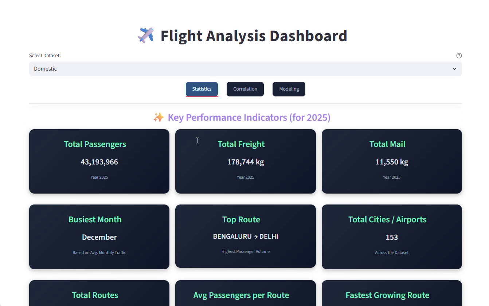
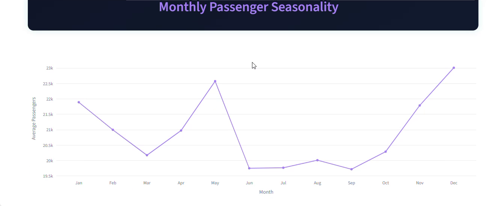
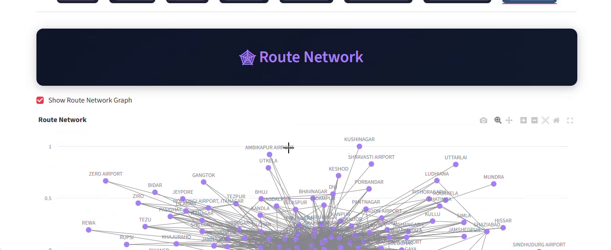
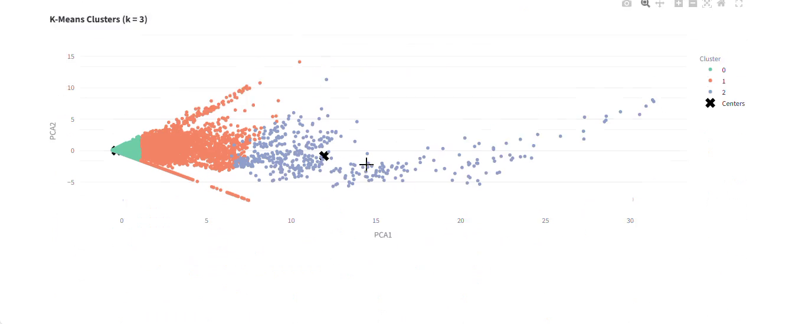
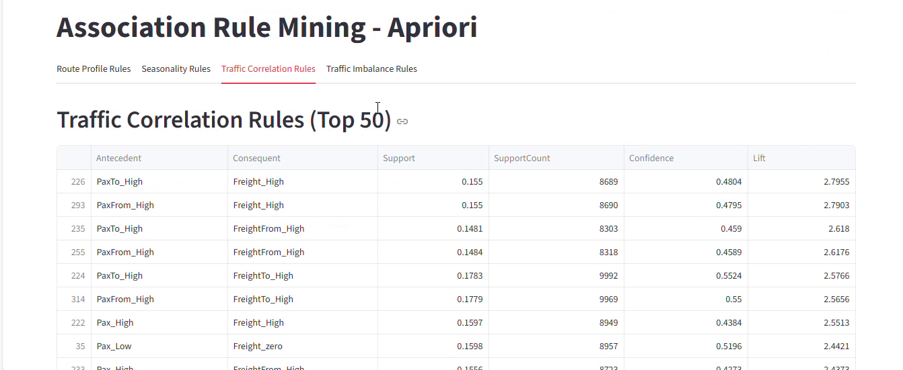

# Flights Analysis: Indian Air Traffic and Flight Delays

This project studies Indian commercial aviation from two angles. The first is traffic: how many passengers, how much freight and how much mail moved between Indian city pairs each month from April 2015 to March 2025, and how international traffic to and from India behaved over the same decade. The second is punctuality: what drove departure and arrival delays on five busy domestic routes between January 2019 and January 2020. The results are presented in an interactive Streamlit dashboard, supported by Jupyter notebooks that clean the raw data and carry out the delay, international and combined analyses.

The full write up of methods, results and limitations is in [report/REPORT.md](report/REPORT.md).

## What the dashboard shows

The dashboard (`1.py`) opens on the domestic dataset and is organised into three main tabs. The Statistics tab gives headline figures for the latest year, the busiest routes and cities, yearly and monthly trends, the split between passengers, freight and mail on each route, and a route explorer that shows any route's monthly pattern, its strongest season and a network graph of all routes. The Correlation tab holds a correlation heatmap of the numeric variables, an interactive univariate and bivariate explorer that picks the right chart for the column types you choose, a yearly comparison of mail and freight, and a button that opens the association rules page. The Modeling tab standardises the numeric features, projects them onto two principal components, shows the PCA loadings, and clusters routes with K Means using an elbow curve to choose k.

The second page (`pages/asso.py`) turns each monthly route record into a basket of items such as the origin, the destination, the month and Low, Medium or High levels of passenger, freight and mail traffic, then mines association rules with an Apriori style algorithm written from scratch. Rules are grouped into seasonality, traffic correlation and traffic imbalance views.



| | |
|---|---|
|  |  |
| Monthly passenger seasonality | Route network |
|  |  |
| K Means clusters (k = 3) | Association rules: traffic correlation |

More screenshots, with descriptions, are in Section 5 of the [report](report/REPORT.md). All of them were taken from the demo recordings.

Two screen recordings of the running app are included. `Recording-1.mp4` (about four minutes) walks through the main dashboard, and `Recording-2.mp4` (about thirty seconds) shows the association rules page.

## Repository contents

| Path | What it is |
|---|---|
| `1.py` | Main Streamlit dashboard (entry point) |
| `pages/asso.py` | Association rule mining page, opened from the dashboard |
| `india_domestic_city_preprocessing.ipynb` | Cleans `city.csv` and writes `domestic_city_processed.csv` |
| `india_international.ipynb` | Cleans `city_internatinal.csv`, explores it and writes `international_city_cleaned.csv` |
| `combined.ipynb` | Puts domestic and international traffic on a common quarterly basis and compares them |
| `flight_delay_analysis.ipynb` | End to end delay analysis: cleaning, features, outliers, correlations, weather, Apriori rules, K Means; writes `flight_delay_cleaned.csv` |
| `delay.ipynb` | Early scratch notebook for the delay data (incomplete, superseded by `flight_delay_analysis.ipynb`) |
| `build_flight_datasets_offline.ipynb` | Builds airport and route tables with coordinates from OurAirports and OpenFlights files |
| `1.ipynb` | Earlier exploratory version of the airport and route merge |
| `city.csv` | Raw domestic city pair traffic, monthly, 56,047 rows |
| `domestic_city_processed.csv` | Cleaned domestic data used by the dashboard |
| `city_internatinal.csv` | Raw international city pair traffic, quarterly, 14,538 rows (file name spelling kept as in the source) |
| `international_city_cleaned.csv` | Cleaned international data |
| `flight_delay.csv` | Raw flight level delay and weather data, 10,718 flights |
| `flight_delay_cleaned.csv` | Cleaned delay data |
| `routes_full_with_coords.csv` | 67,663 world airline routes with airport coordinates |
| `airports_india.csv` | 148 Indian airports with codes and coordinates |
| `airlines.dat` | OpenFlights airline reference table |
| `report/` | Project report, its analysis figures and dashboard screenshots |
| `Recording-1.mp4`, `Recording-2.mp4` | Demo recordings of the dashboard |

## Getting started

You need Python 3.10 or newer. The project has been tested on Python 3.13. From the repository root, create a virtual environment and install the dependencies:

```bash
python -m venv .venv
# Windows
.venv\Scripts\activate
# macOS / Linux
source .venv/bin/activate

pip install -r requirements.txt
```

Then start the dashboard from the repository root, so that the CSV files and the `pages` folder are found:

```bash
streamlit run 1.py
```

It opens at http://localhost:8501. The association rules page is reached through the Correlation tab, under Association rules, or directly from the sidebar. The first load takes a little while because the route network, the elbow curve and the rule mining are computed on all 56,047 records.

To work with the notebooks, run `jupyter notebook` (or open them in JupyterLab or VS Code) from the same folder.

## Reproducing the processed files

The processed CSV files are already committed, so the dashboard runs without any preprocessing. To rebuild them, run `india_domestic_city_preprocessing.ipynb` to regenerate `domestic_city_processed.csv`, `india_international.ipynb` to regenerate `international_city_cleaned.csv`, and `flight_delay_analysis.ipynb` to regenerate `flight_delay_cleaned.csv`. The comparison in `combined.ipynb` reads the first two outputs, so run it after them. These four notebooks run unchanged with the versions in `requirements.txt`.

`build_flight_datasets_offline.ipynb` and `1.ipynb` need raw reference files that are not in the repository. Download `airports.csv`, `countries.csv` and `regions.csv` from [OurAirports](https://ourairports.com/data/) and `airports.dat` and `routes.dat` from [OpenFlights](https://openflights.org/data.php), place them in a `data_in/` folder, and run `build_flight_datasets_offline.ipynb`. Its outputs are written to `data_out/`.

## Data sources

The domestic and international traffic tables follow the layout of the city pair traffic statistics published by India's Directorate General of Civil Aviation (DGCA), with passengers counted in numbers and freight and mail in tonnes. The yearly domestic passenger totals in the file agree with DGCA's published annual figures (for example about 144 million in 2019 and 152 million in 2023). Airport and route reference data come from OurAirports and OpenFlights. The source of the flight delay dataset, which combines flight times with hourly weather observations, is not recorded in this repository and should be credited here once confirmed.

## Things to know about the data

A few properties of the data change how results should be read, and they are discussed in detail in the report. Cancelled flights in the delay data are coded with a delay of 1,440 minutes, so averages that include them roughly double the apparent delay for some airlines. Freight and mail were not reported for 2015 to 2017, and the preprocessing filled those gaps with column medians, so freight and mail trends are only meaningful from 2018. The source sometimes lists the same city pair in both orders in different years (Mumbai and Delhi, for example), so route rankings should combine both orders. The domestic file covers April 2015 to March 2025 and has no May records for 2021 or 2024, which matters when comparing yearly totals.

## Author

Ruthvi Maram, B.Tech in Data Science and Engineering, IIT Palakkad.
