# Flights Analysis: Indian Air Traffic and Flight Delays

Project report for the [Flights-Analysis](https://github.com/Ruthvi5/Flights-Analysis) repository.
Author: Ruthvi Maram, B.Tech in Data Science and Engineering, IIT Palakkad.

## Abstract

This project analyses ten years of Indian city pair air traffic and a year of flight level delay records. Monthly domestic traffic for 153 cities (April 2015 to March 2025) and quarterly international traffic for 1,122 city pairs (2015 to mid 2025) were cleaned, enriched with totals and growth rates, explored statistically, reduced with principal component analysis, clustered with K Means and mined for association rules. A separate dataset of 10,718 flights on five busy domestic routes was used to study delays and their relationship with airline, route, time of day and weather. The results are delivered through an interactive Streamlit dashboard. The traffic data reproduce the national picture closely: domestic passengers grew from about 99 million in 2016 to 144 million in 2019, fell by 56 percent in 2020, and reached a record 152 million in 2023, while international traffic fell further (73 percent) and recovered later, passing its 2019 level only in 2024. Delhi and Mumbai form the busiest domestic pair by a wide margin, passenger and freight volumes move together strongly, and seasonality at route level is real but mild. In the delay data, once cancelled flights are separated out, the typical flight is close to on time (median three minutes, 71 percent within fifteen minutes), delays build steadily through the day, and recorded weather variables show almost no linear relationship with delay. Several data quality issues that materially change the conclusions are documented, chief among them a 1,440 minute placeholder used for cancelled flights.

## 1. Introduction and objectives

India is one of the fastest growing aviation markets in the world, and the Directorate General of Civil Aviation (DGCA) publishes detailed city pair statistics that make it possible to study that growth route by route. The project set out to answer four groups of questions. How has passenger, freight and mail traffic evolved over the decade, and how deep and how lasting was the effect of the pandemic? Which routes and cities dominate, and are there consistent seasonal patterns? Can routes be grouped into meaningful segments, and which traffic characteristics tend to occur together? Finally, using a separate flight level dataset, how large are delays, which airlines and routes are most affected, and does weather explain them?

## 2. Data

Four main datasets were used, together with reference tables of airports and routes.

| Dataset | File | Records | Coverage | Granularity |
|---|---|---|---|---|
| Domestic city pair traffic | `city.csv` | 56,047 | April 2015 to March 2025 | Month, city pair |
| International city pair traffic | `city_internatinal.csv` | 14,538 | Q1 2015 to Q2 2025 | Quarter, city pair |
| Flight delays with weather | `flight_delay.csv` | 10,718 | 2 January 2019 to 31 January 2020 | Individual flight |
| World routes with coordinates | `routes_full_with_coords.csv` | 67,663 | OpenFlights snapshot | Airline route |

The domestic table follows DGCA's city pair layout: for each month and pair of cities it gives passengers to and from the second city, freight to and from it, and mail to and from it. Passengers are counted in numbers and freight and mail in tonnes. The international table has the same structure without mail and is reported by quarter, with two digit years. The delay table records, for each flight, the date, origin, destination, airline, scheduled and actual departure and arrival times, departure and arrival delay in minutes, a status flag, distance, load factor, airline and airport ratings, market share, an on time performance index and hourly weather at the time of the flight (wind speed, precipitation, humidity, visibility, pressure, cloud cover and a text description). The airport and route reference tables were assembled from OurAirports and OpenFlights in `build_flight_datasets_offline.ipynb`, matching airports first by IATA code, then by ICAO code and finally by OpenFlights identifier, which left only 15 source and 16 destination airports without coordinates out of 67,663 routes.

As a check on the domestic data, the yearly passenger totals were compared with DGCA's published national figures. Full years agree to within rounding, and the two years that fall short are exactly the years in which one month is missing from the file (Table 1).

## 3. Methodology

### 3.1 Domestic preprocessing

Column names were normalised to lower case. The raw file has no missing passenger values, but about 11,700 records lack freight and mail values. Of these, 10,820 fall in 2015 to 2017, where every record is affected, and 874 in early 2018, so freight and mail were evidently not reported in the city pair series before 2018. These gaps were filled with the column median. Outliers were identified with a Z score rule (absolute Z above 3), which flagged between 836 and 1,333 records per traffic column; they were kept rather than removed, because on this kind of data they are the genuine trunk routes rather than errors. City names were trimmed and upper cased, a monthly date was constructed from year and month, and three totals were derived by adding the two directions: total passengers, total freight and total mail. A route level growth percentage was computed as the change from the previous available record for the same route, and a traffic type label was added. The result is `domestic_city_processed.csv`, which the dashboard reads.

### 3.2 International preprocessing and the combined view

The international table was treated in the same way. Two digit years were converted to calendar quarters with a quarter end date, totals and quarter on quarter growth were derived, standardised copies of the numeric columns were added, and the output was saved as `international_city_cleaned.csv`. To compare the two markets on a common basis, `combined.ipynb` aggregated domestic months into quarters and appended the international records, giving one table of quarterly traffic by route and traffic type.

### 3.3 Exploratory analysis and modelling in the dashboard

The dashboard computes headline figures for the latest year, rankings of routes and cities, yearly and monthly passenger trends, the passenger, freight and mail composition of the busiest routes, and a per route view that reports average monthly passengers, the most common month and the strongest season under a five season Indian calendar (winter, spring, summer, monsoon and festive). A correlation heatmap and an interactive explorer cover univariate and bivariate relationships, choosing a scatter plot with an ordinary least squares trendline, a box plot or a cross tabulation heatmap according to the column types.

For modelling, the numeric features were standardised and projected onto two principal components, with the loadings shown alongside. Route months were clustered with K Means on the standardised total passengers, total freight and total mail. An elbow curve of inertia against k from 1 to 10 is drawn and k = 3 was chosen from it.

### 3.4 Association rule mining

Each domestic record was turned into a basket of twelve items: the origin city, the destination city, the month, and Low, Medium or High (and, for freight and mail, Zero) levels for total and directional passengers, freight and mail, using fixed thresholds (for example, fewer than 2,000 total passengers is Low and more than 10,000 is High). Frequent single items and item pairs were counted with an Apriori style procedure written from scratch, using a minimum support of 1 percent and a minimum confidence of 0.4, and support, confidence and lift were reported for every one item to one item rule. This produced 492 rules, which the dashboard groups into seasonality rules (a month on the left side), traffic correlation rules (a passenger level implying a freight or mail level) and route rules (an origin or destination implying a passenger level).

### 3.5 Flight delay analysis

The delay notebook parsed the day first dates, converted clock times to minutes since midnight, imputed any missing numeric values with the median and categorical values with the mode, and derived calendar features, a route label and an average delay defined as the mean of the departure and arrival delays. Flights were classed as on time (15 minutes or less), moderately delayed (15 to 60 minutes) or severely delayed (over 60 minutes). The analysis then covered Z score outliers, a correlation matrix, rankings of airlines, routes and airports, monthly and day of week by hour patterns, correlations between delay and each weather variable, Apriori rules relating discretised weather to delay category (using mlxtend), and K Means clustering on delay, distance, load factor, ratings and three weather variables. For this report the key summaries were recomputed after removing cancelled flights, for the reason explained in Section 4.6.

## 4. Results

### 4.1 Growth, collapse and recovery

**Table 1. Domestic passengers by calendar year (millions)**

| Year | Passengers in dataset | Months in file | DGCA published |
|---|---|---|---|
| 2015 | 62.3 | 9 (April to December) | |
| 2016 | 99.5 | 12 | |
| 2017 | 116.8 | 12 | |
| 2018 | 138.7 | 12 | |
| 2019 | 143.7 | 12 | 144 |
| 2020 | 62.9 | 12 | 63 |
| 2021 | 80.7 | 11 (no May) | 84 |
| 2022 | 123.2 | 12 | 123.2 |
| 2023 | 152.0 | 12 | 152.0 |
| 2024 | 147.5 | 11 (no May) | 161.3 |
| 2025 | 43.2 | 3 (January to March) | |

Domestic traffic grew by about 44 percent between 2016 and 2019. In 2020 it fell by 56 percent, then recovered in two steps and set a new record of 152.0 million in 2023, about 6 percent above 2019. International traffic (Figure 1) grew more slowly before the pandemic, from 49.1 million in 2015 to 64.3 million in 2019, but fell much harder, by 73 percent, and stayed at about 17 million in both 2020 and 2021. It returned to roughly its 2019 level in 2023 (63.9 million) and reached a record 72.2 million in 2024, 12 percent above 2019. Across the full period domestic traffic accounts for 68 percent of all passengers in the two datasets and international traffic for 32 percent.

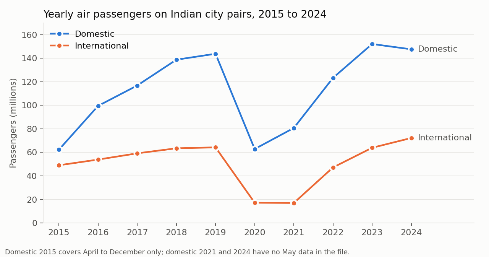

*Figure 1. Yearly passengers on Indian city pairs. Domestic 2015 covers April to December only, and domestic 2021 and 2024 lack May.*

Freight and mail cannot be read the same way. Their yearly totals jump from a few thousand tonnes in 2015 to 2017 to over 600,000 tonnes of freight in 2018, but this is an artefact: those early years were not reported and were filled with small medians. From 2018 onward freight moves with passengers, dipping in 2020 and recovering to about 697,000 tonnes in 2023.

### 4.2 Routes and cities

The dataset contains 153 cities and 1,679 directional route labels. Because the source sometimes lists the same pair in both orders in different years (Mumbai to Delhi until 2023, Delhi to Mumbai from 2019), the routes were also ranked as unordered pairs, of which there are 1,480. On that basis Delhi and Mumbai is the busiest domestic pair by a clear margin, with 56.7 million passengers over the decade, followed by Bengaluru and Delhi (37.5 million) and Bengaluru and Mumbai (31.8 million) (Figure 2). Delhi appears in seven of the top ten pairs. Ranked by passengers handled, the leading cities are Delhi (217 million), Mumbai (151 million), Bengaluru (116 million), Hyderabad (78 million) and Kolkata (76 million).

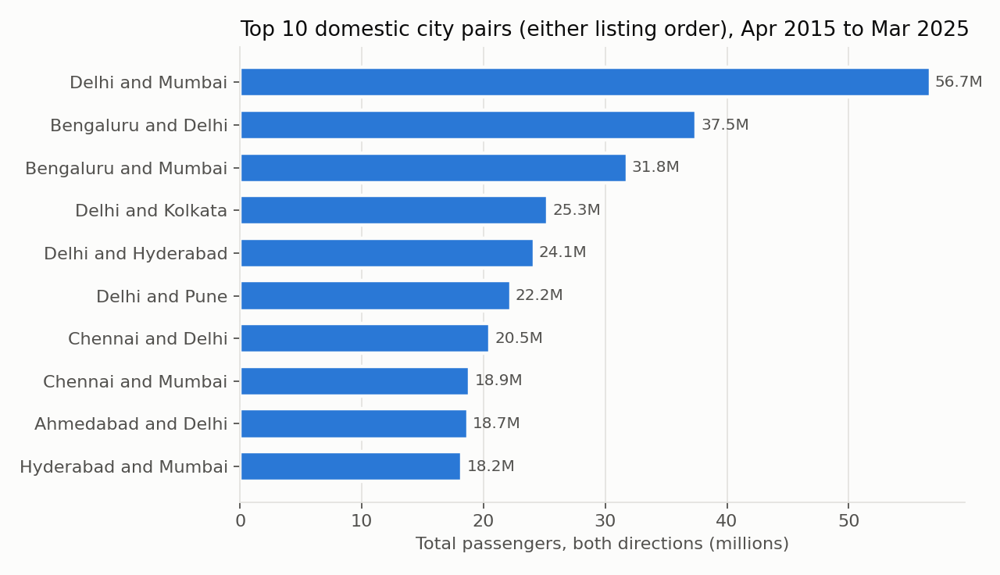

*Figure 2. Top ten domestic city pairs, combining both listing orders.*

On international routes the Gulf dominates. Dubai to Mumbai (21.0 million) and Dubai to Delhi (18.4 million) are the two largest pairs, followed by London to Delhi (9.5 million), Dubai to Kochi (9.4 million) and Dubai to Hyderabad (9.1 million). Among Indian cities, Delhi (72.4 million passengers flown in on international routes) and Mumbai (52.7 million) are far ahead of Chennai (22.9 million), Kochi (20.3 million) and Bengaluru (17.6 million). The prominence of Kochi, Kozhikode and Trivandrum reflects the strong links between Kerala and the Gulf.

### 4.3 Seasonality

Average passengers per route per month are highest in December (23,011), May (22,576), January (21,893) and November (21,789) and lowest from June to September (about 19,700 to 20,000), consistent with winter holidays, the summer vacation before the monsoon, and a monsoon lull. The gap between the strongest and weakest month is about 17 percent. The association rules agree that the effect exists but is modest: December implies a High passenger level with confidence 0.40 and lift 1.10, and May implies Low freight with confidence 0.45 and lift 1.14 and Low outbound freight with lift 1.19. Lifts this close to 1 mean that the month shifts the odds only slightly, so seasonality is better described as a gentle swing than as a defining property of routes.

### 4.4 Passengers, freight and mail together

Passenger, freight and mail volumes are strongly related. On the domestic data the correlation of total passengers with total freight is 0.72, with total mail 0.60, and freight with mail 0.66; on international routes passengers and freight correlate at 0.65. The rules make the same point more sharply: a High inbound passenger level implies High total freight with confidence 0.48 and lift 2.80, and High inbound freight with confidence 0.55 and lift 2.58, so a high passenger route is roughly two and a half to three times as likely as an average route to also carry high freight. This is consistent with most domestic cargo travelling in the bellies of passenger aircraft.

### 4.5 Route segments and hub cities

The elbow curve flattens noticeably after three clusters (inertia falls from 168,141 at k = 1 to 87,502 at k = 2 and 60,586 at k = 3, then more slowly). The three clusters separate the long tail of small routes from the trunk routes. The first holds 51,868 route months with on average 11,672 passengers, 21 tonnes of freight and 2 tonnes of mail per month; the second holds 3,726 route months averaging 115,481 passengers and 484 tonnes of freight; the third holds 453 route months averaging 297,759 passengers and 3,616 tonnes of freight. A silhouette score computed for this report on a random sample of 10,000 records is 0.81, but given how skewed the data are this mostly reflects the gap between a few very large routes and everything else rather than three evenly balanced segments.

The route rules identify hub behaviour rather than one directional imbalance. Routes ending in Delhi have High traffic in both directions with confidence 0.66 and lift about 2.05, routes starting in Mumbai show the same pattern (confidence 0.60, lift 1.84), and routes from Indore are typically Medium in both directions (confidence 0.61, lift 1.78).

### 4.6 Flight delays

The delay data cover five routes (Bengaluru to Delhi, Bengaluru to Mumbai, Kolkata to Delhi, Delhi to Hyderabad and Mumbai to Delhi) and six airlines, with IndiGo accounting for 4,053 of the 10,718 flights. Although the dates run from January 2019 to January 2020, 94 percent of the usable flights fall in November 2019 to January 2020, so the results describe a winter sample above all.

The most important finding concerns the data rather than the airlines. All 76 flights with status 0 have no actual departure or arrival time and a recorded delay of exactly 1,440 minutes, which is a placeholder for a cancelled flight rather than a real day long delay. Left in, these flights dominate every average: they account for 76 of the 91 outliers flagged in the notebook, and they roughly double the apparent mean delay for Air India (53.8 to 27.7 minutes) and IndiGo (21.2 to 9.9 minutes) (Figure 3). All figures below exclude them, and cancellations are better studied as a separate outcome: Air India (30) and IndiGo (32) account for most of them, and Kolkata to Delhi (31) and Mumbai to Delhi (23) are the most affected routes.

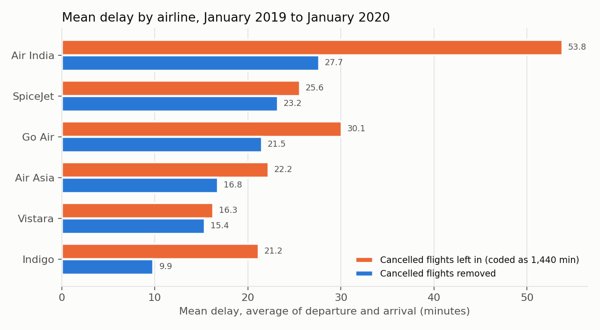

*Figure 3. Mean delay by airline with the 1,440 minute cancellation placeholder left in and removed. SpiceJet appears under two spellings in the raw data and is combined here.*

With cancellations removed, the 10,642 operated flights have a mean average delay of 16.8 minutes but a median of only 3 minutes; 71.0 percent arrive within 15 minutes of schedule, 20.7 percent are moderately delayed and 8.3 percent are severely delayed. Departure and arrival delays are strongly linked (correlation 0.66), as expected when late departures propagate. IndiGo has the lowest mean delay (9.9 minutes, median 0) and Air India the highest (27.7 minutes, median 8.5). Among routes, Delhi to Hyderabad (21.9 minutes), Mumbai to Delhi (18.9) and Kolkata to Delhi (18.5) are the slowest and Bengaluru to Mumbai the most punctual (12.7). The clearest operational pattern is time of day: flights scheduled before 6 a.m. average 4.1 minutes of delay, rising to 13.0 minutes in the morning, 20.4 minutes in the afternoon and 23.2 minutes in the evening, which is the familiar build up of knock on delays through an aircraft's day.

Weather explains little. The correlation between delay and each of wind speed, precipitation, humidity, visibility, pressure and cloud cover is below 0.1 in absolute value, and grouping by the weather description gives no consistent story (flights in rain average 13.1 minutes against 20.4 minutes in clear conditions). The Apriori search for weather patterns that imply a delay category returned no rules at the chosen thresholds. Hourly weather at a single point is probably too coarse to capture the fog and congestion events that cause the worst delays, so this is an absence of evidence rather than evidence that weather does not matter.

## 5. The dashboard

The Streamlit application brings the domestic analysis together in one place. Its Statistics tab shows the headline figures, the top routes and cities, yearly and monthly trends, traffic composition and a route explorer with seasonal classification and a network graph. Its Correlation tab provides the heatmap, the univariate and bivariate explorer, the mail and freight comparison and the link to the association rules page. Its Modeling tab contains the standardisation preview, the PCA projection and loadings, and the K Means clustering with the elbow curve and cluster summary. The association rules page lets the user browse all rules and filter seasonality rules by month. The application was tested headlessly with the package versions in `requirements.txt` and runs both pages without errors. The screenshots below were taken from the two demo recordings in the repository.

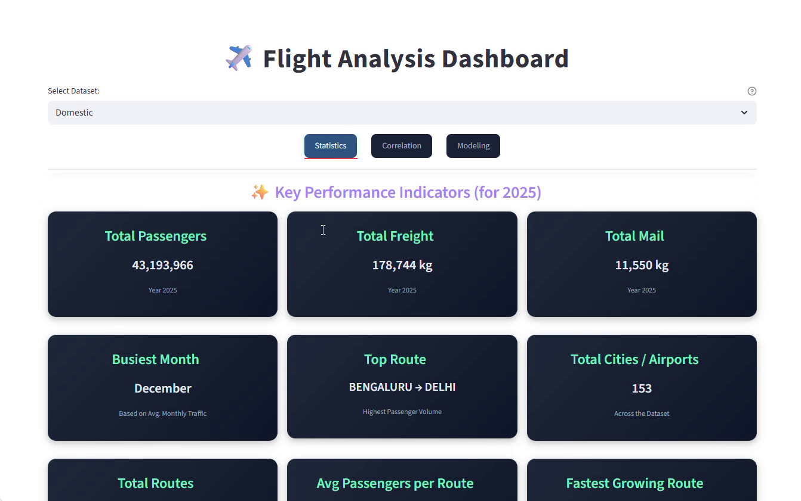

*Figure 4. The dashboard header and the Overview tab. The indicator cards summarise the latest year in the file (January to March 2025) together with whole period figures such as the busiest month and the number of cities. The Top Route card and the kilogram labels are affected by the issues described in Section 6.*

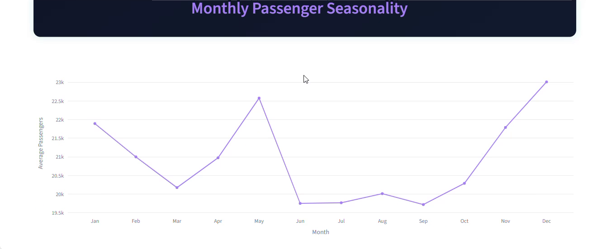

*Figure 5. Average passengers per route by calendar month, showing the December and May peaks and the June to September trough discussed in Section 4.3.*

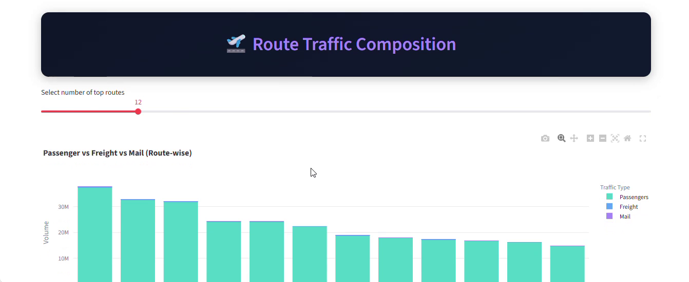

*Figure 6. Passengers, freight and mail on the busiest routes, with a slider for the number of routes shown. Passenger counts dwarf freight and mail tonnages on a shared axis, so the composition is easier to read in the accompanying data table.*

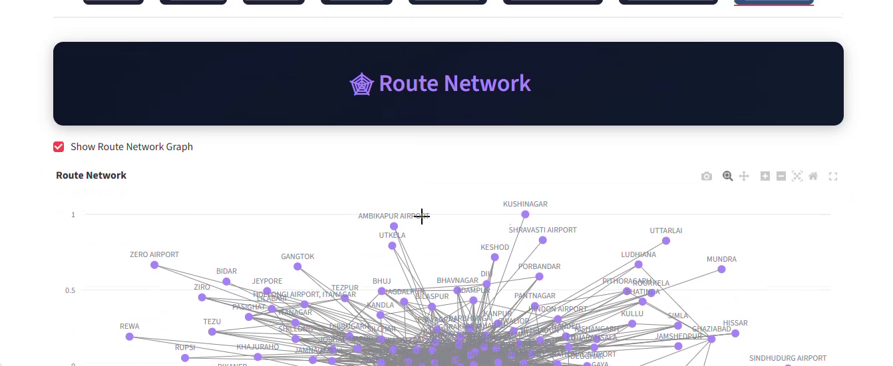

*Figure 7. The domestic route network drawn with a force directed layout. Cities with few links sit on the outside, while the heavily connected hubs crowd the centre.*

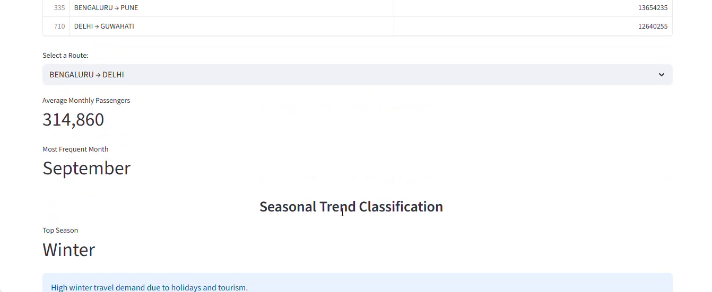

*Figure 8. The route explorer for Bengaluru to Delhi, reporting average monthly passengers, the most frequent month and the strongest season with a short interpretation.*

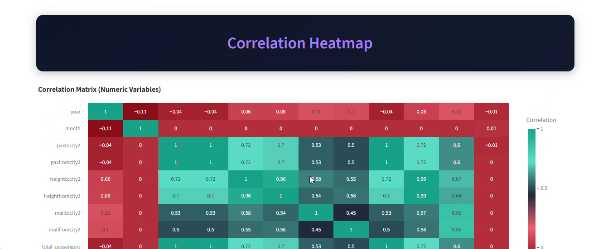

*Figure 9. Correlation matrix of the numeric variables. The directional passenger columns correlate almost perfectly with each other and at about 0.7 with freight, as reported in Section 4.4.*

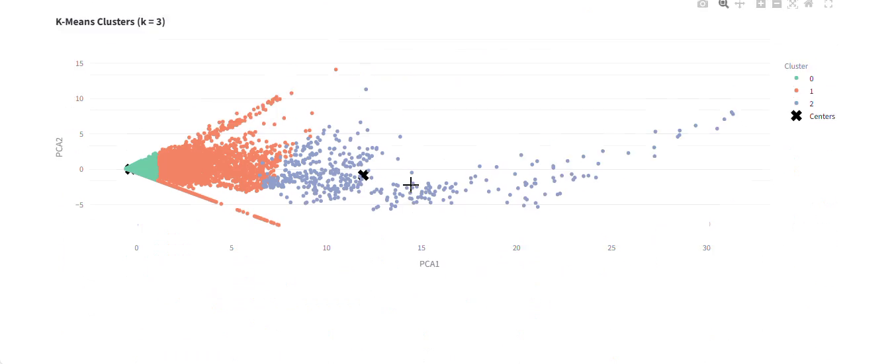

*Figure 10. Route months coloured by K Means cluster (k = 3) and plotted on the first two principal components, with cluster centres marked. The large group of small routes sits at the left and the few trunk route months stretch out to the right.*

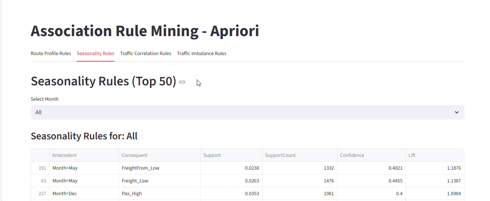

*Figure 11. The seasonality tab of the association rules page, with a month filter. The strongest rules (May with low freight, December with high passengers) have lifts only slightly above 1.*

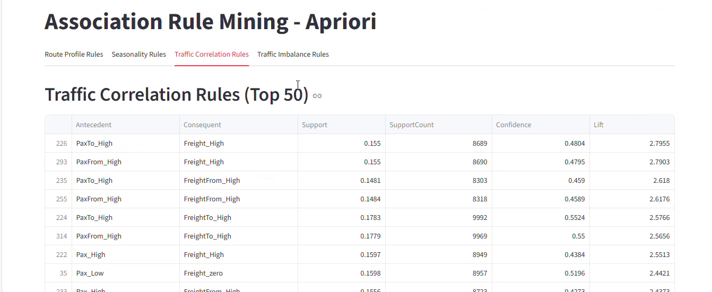

*Figure 12. The traffic correlation tab, where high passenger levels imply high freight levels with lifts of about 2.6 to 2.8.*

## 6. Limitations and data quality

Several limitations should be kept in mind when reading or extending these results. The cancellation placeholder described in Section 4.6 affects every delay statistic in `flight_delay_analysis.ipynb`, including the airline and route rankings and the outlier count, and SpiceJet appears under two spellings, which splits that airline's figures. The delay data cover only five routes and are concentrated in three winter months, so they should not be generalised to the whole network or the whole year.

In the traffic data, freight and mail for 2015 to 2017 are median imputations of unreported values, so any trend or correlation that uses those years overstates what is known; the dashboard labels freight and mail in kilograms, whereas the source reports tonnes. The listing order of city pairs changes over time, so the dashboard's busiest route figure (Bengaluru to Delhi) understates the true leader, Delhi and Mumbai, whose traffic is split across two labels. September 2015 contains 36 records in which the same pair and month appear twice, together about 1.1 million passengers. May is missing for 2021 and 2024, and 2015 and 2025 are partial years. The route growth percentage compares each record with the previous available record rather than the previous calendar month, so gaps produce extreme values (up to about 2.4 million percent) that make its mean meaningless.

On the modelling side, the PCA tabs use every numeric column, including year, month and the growth percentage, which mixes calendar position with traffic volume. The number of clusters is fixed at three after the elbow plot rather than selected automatically, and the silhouette check in the code is commented out. The explanatory text on the association rules page quotes figures and a threshold (Pax High above 5,000 passengers) that do not match the rules the page currently computes (the threshold in the code is 10,000), and the rule miner considers only one item to one item rules.

## 7. Future work

The most valuable next steps follow from the limitations. Treating cancellations as their own outcome, merging airline name variants and extending the delay data to more routes and a full year would make the delay analysis representative. Normalising city pairs to a fixed order, dropping duplicate records and restricting freight and mail analysis to 2018 onward would remove the main distortions in the traffic analysis, and correcting the units and the busiest route figure in the dashboard would follow directly. Clustering on log scaled volumes, adding route level features such as distance and seasonality strength, and choosing k with silhouette or gap statistics would produce more informative segments. Finally, the yearly series is long enough to support forecasting of route level demand, and the international table could be enabled in the dashboard's dataset selector, which currently offers only the domestic data.

## 8. Conclusion

The project shows that publicly available DGCA city pair data, once cleaned, reproduce the national story of Indian aviation closely: steady growth to 2019, a deep pandemic shock that hit international travel hardest, and a recovery to record levels by 2023 for domestic and 2024 for international traffic. Traffic is highly concentrated on a few trunk routes centred on Delhi, Mumbai and Bengaluru, passenger and freight demand move together, and seasonal swings are present but modest. The delay analysis shows that most flights on the busy routes studied were close to on time, that delays accumulate through the day, and that point weather readings add little explanatory power. Just as importantly, the work shows how much a few data conventions, such as a placeholder value for cancellations or a change in how city pairs are listed, can change headline conclusions, and why checking them is part of the analysis rather than a preliminary.

## References

Directorate General of Civil Aviation, Government of India. City pair wise scheduled domestic and international traffic statistics.

DGCA annual domestic passenger figures as reported in the press: [Business Standard, January 2024](https://business-standard.com/industry/news/domestic-air-passenger-traffic-grew-8-34-to-152-mn-in-2023-dgca-data-124011500772_1.html) (2023 and 2022), [Trak.in, January 2024](https://trak.in/stories/4-lakh-indians-flew-every-day-in-2023-15-2-crore-domestic-flyers-sets-new-aviation-record-in-india-highest-ever-in-a-year/) (2019 and 2020), [Vikatan, January 2024](https://english.vikatan.com/news/indias-domestic-air-travel-surges-to-new-heights-with-152-crore-passengers-in-2023) (2021) and [Bangladesh Monitor, January 2025](https://bangladeshmonitor.com.bd/en/indias-domestic-air-traffic-exceeds-1613-crore-in-2024) (2024).

OurAirports open data, https://ourairports.com/data/

OpenFlights airport, airline and route data, https://openflights.org/data.php

Software: Python, pandas, NumPy, scikit-learn, Streamlit, Plotly, NetworkX, statsmodels, Matplotlib, seaborn and mlxtend.
